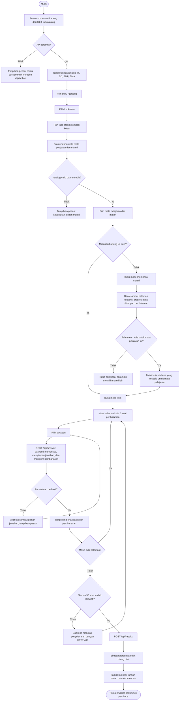
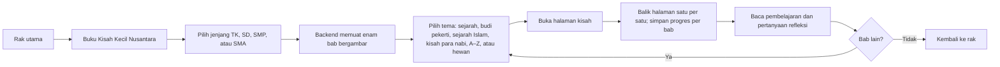
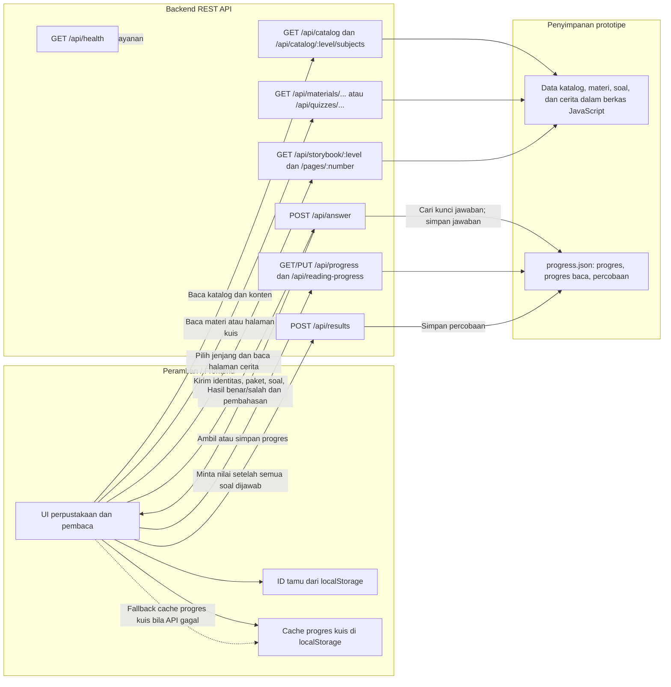

# Flowchart Cerdas Cermat

Dokumen ini menggambarkan alur yang tersedia pada prototipe saat ini, bukan rancangan fitur masa depan. Diagram menggunakan Mermaid dan dapat dilihat di editor Markdown yang mendukung Mermaid.

## 1. Alur belajar pengguna

### Catatan perilaku saat ini

- Materi dan kuis diambil dari API; frontend statis berjalan terpisah dari backend.
- Katalog memuat TK, SD, SMP, dan SMA serta opsi Kurikulum Merdeka, K13, dan Darurat/arsip. Ketersediaan nyata bergantung pada isi katalog.
- Topik yang tersedia sebagai kuis dibuka langsung ke kuis. Topik tanpa kuis membuka empat halaman ringkasan materi.
- Ketika pembacaan materi selesai, sistem mencari kuis pertama yang tersedia untuk mata pelajaran tersebut. Keterkaitan spesifik antara topik yang dibaca dan topik kuis belum terlihat dijamin di alur ini; perlu ditetapkan dan diuji sebelum konten diperluas.
- Kuis terdiri dari 50 soal, tiga soal per halaman. Backend memeriksa jawaban satu per satu dan baru membuat hasil setelah semua soal dijawab.
- Hasil kuis disimpan sebagai percobaan; daftar riwayat dibatasi hingga 100 percobaan per identitas.
- Identitas belajar dibuat di peramban dan progres lokal menggunakan `localStorage`; tidak ada login atau sinkronisasi antarperangkat.
- Materi ringkas dan bank soal ditandai sebagai draf yang perlu ditelaah guru. Jangan gunakan sebagai penilaian resmi sebelum validasi.

## 1A. Alur buku cerita terpisah

Buku cerita adalah pilihan terpisah dari buku kuis jenjang. Bab sejarah Islam dan kisah para nabi memiliki beberapa halaman adegan serta halaman makna yang disesuaikan dengan jenjang; tiap halaman menggunakan ilustrasi lokal dan rujukan ayat atau hadis. Ilustrasi kisah nabi memakai simbol dan latar tanpa menggambarkan sosok nabi. Bab agama umum tetap inklusif; penelaahan guru tetap disarankan.

## 2. Alur penyimpanan dan layanan

## 3. Permukaan API yang terkait alur

| Kebutuhan | Endpoint |
|---|---|
| Memuat jenjang dan daftar kurikulum | `GET /api/catalog` |
| Memuat mapel dan topik untuk konteks belajar | `GET /api/catalog/:level/subjects?curriculum=...&phase=...` |
| Memuat satu halaman materi | `GET /api/materials/:level/:subject/:topic/pages/:number` |
| Memuat satu halaman kuis | `GET /api/quizzes/:level/:subject/pages/:number` |
| Memuat katalog buku cerita per jenjang | `GET /api/storybook/:level` |
| Memuat satu halaman cerita | `GET /api/storybook/:level/pages/:number` |
| Memeriksa dan menyimpan jawaban | `POST /api/answer` |
| Memuat/menyimpan progres kuis | `GET /api/progress/:studentId`, `PUT /api/progress` |
| Memuat/menyimpan progres membaca | `GET /api/reading-progress/:studentId`, `PUT /api/reading-progress` |
| Menyimpan hasil setelah kuis lengkap | `POST /api/results` |
| Memeriksa kesehatan backend | `GET /api/health` |

Endpoint kompatibilitas `GET /api/books/:id/pages/:number` masih tersedia untuk paket Matematika.
